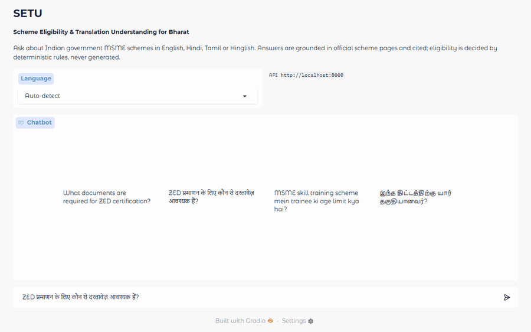

# SETU

**Multilingual, cited RAG over Indian government MSME schemes — with an eligibility engine that never guesses.**

[](https://www.python.org/)
[](tests/)
[](eval/history/2026-08-15.json)

<p align="center">
  
</p>
<p align="center"><sub>A Hindi question, a cited Hindi answer, and the source it came from.</sub></p>

---

## The problem

India runs hundreds of MSME and welfare schemes, but their eligibility rules are
buried in English PDFs and JavaScript-rendered portals that the people who most
need them cannot easily read. Generic chatbots answer these questions fluently
and sometimes wrongly — and a confident *"yes, you qualify for a ₹10 lakh
subsidy"* sends someone to a government office with paperwork that will be
rejected. SETU answers in the user's own language, cites the official page behind
every claim, and decides eligibility with deterministic rules that the language
model is structurally forbidden to override.

## Architecture

```mermaid
flowchart LR
    Q(["user query<br/>hi · ta · hinglish · en"])
    LANG["detect language<br/>+ translate to English<br/><i>IndicLID · Azure Translator</i>"]
    CLS["classify intent<br/>+ extract profile"]
    RET["hybrid retrieve<br/><i>dense + BM25<br/>RRF-fused in Qdrant</i>"]
    RER["rerank<br/><i>Jina reranker-v2<br/>cross-encoder</i>"]
    ELG{{"check eligibility<br/><b>deterministic · no LLM</b>"}}
    GEN["generate answer<br/><i>grounded · cites chunk ids</i>"]
    CRIT{"faithful<br/>enough?"}
    OUT["translate back<br/>to user's language"]
    ANS(["cited answer<br/>+ eligibility verdict"])

    Q --> LANG --> CLS --> RET --> RER --> ELG --> GEN --> CRIT
    CRIT -->|"no · &lt; 0.7, retry ≤ 2"| RET
    CRIT -->|yes| OUT --> ANS

    subgraph ING["INGESTION · offline"]
        direction TB
        SRC["myScheme SPA pages<br/>scheme PDFs"]
        CH["clean · strip boilerplate<br/>parent/child chunking"]
        QD[("Qdrant Cloud<br/>dense + sparse BM25")]
        SRC -->|"Crawl4AI · Docling"| CH -->|"Jina embeddings-v3 · 1024-d"| QD
    end

    QD -.->|"search"| RET
    RULES[/"eligibility_rules.json<br/><i>hand-authored · auditable</i>"/] -.->|"rules"| ELG

    classDef det fill:#0b7285,stroke:#063d47,color:#ffffff,stroke-width:2px
    classDef store fill:#5f3dc4,stroke:#3b2596,color:#ffffff,stroke-width:2px
    classDef io fill:#1864ab,stroke:#0d3f6e,color:#ffffff,stroke-width:2px
    class ELG,RULES det
    class QD store
    class Q,ANS io
```



The **teal** components are the ones an LLM never touches — eligibility is
computed by auditable Python rules, not generated. The arrow looping back from
*faithful enough?* to *hybrid retrieve* is what makes this an agent rather than a
pipeline: the graph scores its own answer and can go back and search differently.

**Serving:** FastAPI (`/query`, `/query/stream` SSE) → Chainlit chat UI ·
**Observability:** Langfuse traces every node ·
**Evaluation:** RAGAS + DeepEval CI gate over a 25-query gold set

Full component-by-component walkthrough: **[docs/ARCHITECTURE.md](docs/ARCHITECTURE.md)**.
Deploying: **[deploy/](deploy/)** — runs on Oracle Cloud Always Free, priced by allocation rather than uptime.

## Quickstart

Every backing service is free-tier cloud — Qdrant Cloud, Jina, Azure
Translator, Groq, Langfuse Cloud — so there's no local infrastructure to run.

```bash
python -m venv venv && venv\Scripts\activate    # source venv/bin/activate on macOS/Linux
pip install -r requirements.txt
cp .env.example .env                            # add GROQ_API_KEY, JINA_API_KEY,
                                                # AZURE_TRANSLATOR_KEY, QDRANT_URL/API_KEY —
                                                # all free tier, see .env.example for signup links
python scripts/ingest.py
uvicorn api.main:app --reload --port 8000       # then: chainlit run ui/chainlit_app.py --port 8001
```

UI at <http://localhost:8001>, API docs at <http://localhost:8000/docs>.

<details>
<summary>Optional: Langfuse tracing and evaluation</summary>

```bash
# Sign up at https://cloud.langfuse.com (free), create a project, paste the
# keys into .env — no local containers needed.

# Fits inside Groq's 100k-token free daily tier. --limit samples
# proportionally across languages, so 15 means 9 hi / 3 ta / 3 hinglish.
python eval/ragas_eval.py --limit 15

pytest eval/deepeval_tests.py -m deepeval -v    # CI quality gate
```

The full 25-query gold set needs roughly 146k tokens, above Groq's free daily
limit for the judge model — either use `--limit 15`, or split generation from
scoring across two days:

```bash
python eval/ragas_eval.py --generate-only                     # caches answers
python eval/ragas_eval.py --from-cache eval/history/_runs/<file>.json
```
</details>

## Evaluation

Scores come from `eval/ragas_eval.py`, judged by Groq `llama-3.1-8b-instant` at
`temperature=0`, over a hand-labelled gold set of 25 queries (15 Hindi, 5 Tamil,
5 Hinglish) whose expected answers each trace to a real chunk in the corpus.
Every report records the generation model used, since scores from different
judges are not comparable.

Metrics are computed on the **English** answer, not the translated output —
otherwise the numbers would measure the translation API rather than the RAG
pipeline.

**Current run** — 15 of the 25 gold-set queries, sampled proportionally
across languages (9 Hindi / 3 Tamil / 3 Hinglish), against the 234-chunk
corpus, generated by `qwen/qwen3.6-27b` and scored by `llama-3.1-8b-instant`.
Zero empty answers, so no score is depressed by a rate-limited blank.

| Metric | Score | Target | |
|---|---|---|---|
| Faithfulness | **0.857** | ≥ 0.90 | ⚠️ below target |
| Context recall | **1.000** | ≥ 0.85 | ✅ |
| Answer relevancy | _not scored in this run_ | ≥ 0.85 | — |
| Context precision | _not scored in this run_ | ≥ 0.80 | — |
| Eligibility accuracy (exact match) | deterministic by construction | 1.00 | ✅ |

Full report: [`eval/history/2026-08-15.json`](eval/history/2026-08-15.json).

**Reading these honestly.** Context recall of 1.000 means retrieval found the
supporting passage for every query. Faithfulness of 0.857 means one in roughly
seven claims across the run drifted from what was retrieved — below the 0.90
target.

**Two concrete, root-caused reasons, not generic noise:**
1. **The reranker occasionally surfaces a tangentially related chunk.** For
   one query about student-project funding, the top-5 included a
   consolidated scheme-summary table row that mixes in a *different*
   scheme's benefit figure under similar wording. The generator faithfully
   cites it as "another source" alongside the correct scheme's own number —
   each figure traces to a real chunk, but presenting two schemes' numbers
   as one answer without disambiguating reads as inconsistent, which is
   exactly what the faithfulness judge penalises.
2. **The generation model classifies eligibility intent frequently**, so
   many answers carry the deterministic eligibility block. That block is
   rule-engine output, not corpus text — 100% accurate, but invisible to a
   metric that checks claims against retrieved passages, so RAGAS marks it
   unsupported. A metric/architecture mismatch, not a hallucination.

**Two metrics are deliberately not scored.** Each metric costs one judge call
per sample, and the judge model is throttled to 6000 tokens per minute; a
four-metric run measures at over 27 hours. Faithfulness and context recall
run instead, and the report records exactly which metrics ran so a
partial run can never be mistaken for a full one.

This is a 15-query subset. It indicates the pipeline works; it is not a claim
about production quality.

A retrieval signal from `scripts/smoke_retrieval.py`:

| Query | Top rerank score |
|---|---|
| "What documents are required for ZED certification?" (in corpus) | **0.977** |
| "Who is eligible for PMEGP?" (**not** in corpus) | **0.008** |

That gap is what lets the agent say "I don't have that scheme" instead of
inventing one.

## Tech stack

| Layer | Choice | Why |
|---|---|---|
| Agent | LangGraph 1.2.9 | Explicit state machine; the self-critique loop needs cycles, not a chain |
| Embeddings | Jina embeddings-v3 (1024-d) | One multilingual space for English, Hindi and Tamil — no per-language index |
| Reranking | Jina reranker-v2-base-multilingual | Cross-encoder; its score doubles as a relevance gate |
| Vector store | Qdrant Cloud | Native sparse vectors + server-side RRF fusion in one round trip |
| Language ID | AI4Bharat IndicLID | Handles romanised Indic text, which generic detectors miss |
| Translation | Azure AI Translator | Managed Indic ↔ English translation via API, no local model weight |
| Generation | Groq `qwen/qwen3.6-27b`, Ollama fallback | Fast free tier; local path keeps demos alive offline |
| Ingestion | Crawl4AI + Docling | myScheme is a JS SPA; Docling preserves the tables holding eligibility rules |
| Serving | FastAPI + Chainlit | SSE streaming; UI is a thin client that only calls the API |
| Observability | Langfuse Cloud | Per-node traces with prompt versions attached |
| Evaluation | RAGAS + DeepEval | RAGAS for trend, DeepEval as a pass/fail CI gate |

Embeddings, reranking, and translation run as managed API calls rather than
locally-loaded model weights — this keeps the serving footprint small enough
to run comfortably on a single free-tier container, with nothing beyond
language identification and the deterministic rules engine ever loaded
in-process.

## Known limitations

Stated plainly — a reviewer will find these anyway.

- **The corpus is 44 schemes, 234 chunks.** Anything else gets an honest "not in
  my sources." Adding schemes means adding URLs and re-running ingest.
- **Source errors propagate.** The Design Scheme page reads `₹ 40,000,00/-`
  (almost certainly ₹40,00,000). SETU reproduces it verbatim. Grounding works;
  the government page is wrong. **Cited, not corrected** — a deliberate choice.
- **Romanised Hindi and Urdu are near-identical**, so IndicLID sometimes prefers
  `urd_Latn`.
- **Faithfulness sits at 0.857, below the 0.90 target.** Root causes are known
  (see Evaluation) but not yet fixed.
- **RAGAS needs a shim.** ragas 0.4.3 imports a module removed in
  langchain-community 0.4.x; `eval/ragas_eval.py` registers a documented stub
  because the alternative breaks the pinned langchain.
- **Feedback persistence is a minimal stub.** The Chainlit data layer persists
  thumbs-up/down comments to a local SQLite file; it does not persist chat
  history or resume sessions.

## Roadmap

- [ ] Expand to 50+ schemes, including central flagships (PMEGP, CGTMSE, MUDRA)
- [ ] Improve faithfulness from 0.857 toward the 0.90 target (see Evaluation)
- [ ] Voice input via AI4Bharat IndicWhisper
- [ ] Per-state scheme filtering from the extracted profile
- [ ] Structured "documents you need" checklist as a separate deterministic tool
- [ ] Deploy live on Oracle Cloud Always Free — setup in [deploy/](deploy/)

## Credits

- **[AI4Bharat](https://ai4bharat.iitm.ac.in/)** — IndicLID, the model behind
  romanised-Indic language detection
- **[Jina AI](https://jina.ai/)** — multilingual embeddings and reranking
- **[Microsoft Azure](https://azure.microsoft.com/products/ai-services/ai-translator)**
  — AI Translator
- **[BAAI](https://huggingface.co/BAAI)** — BGE-M3, used by RAGAS to score
  answer relevancy in evaluation
- **[Qdrant](https://qdrant.tech/)** — vector store with native hybrid fusion
- **[LangChain / LangGraph](https://langchain-ai.github.io/langgraph/)** — agent framework
- **[Groq](https://groq.com/)** — inference
- **[Langfuse](https://langfuse.com/)**, **[RAGAS](https://docs.ragas.io/)**,
  **[DeepEval](https://docs.confident-ai.com/)** — observability and evaluation
- **[myScheme](https://www.myscheme.gov.in/)** — Government of India scheme data

Scheme information is reproduced from official government sources for
informational purposes. **Always verify eligibility with the relevant department
before applying.**
