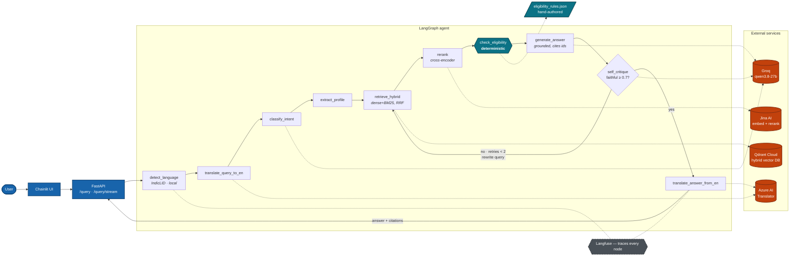

# SETU — Architecture

A walkthrough of every component, written for someone reading the repo to judge
whether the engineering is sound. It explains **why** each choice was made, and
is honest about what does not work.

---

## 1. The problem this shape solves

Three constraints drive the whole design.

1. **The corpus is English; the users are not.** Scheme pages on myScheme are
   published in English. Users ask in Hindi, Tamil, and romanised Hinglish.
2. **Wrong answers here cause real harm.** A hallucinated citation is
   embarrassing. A hallucinated *"yes, you qualify for a ₹10 lakh subsidy"*
   sends someone to a government office with paperwork they cannot use.
3. **Government sources are messy.** Portal HTML mixes real content with
   navigation, hidden modals, and embedded SVG path data.

Constraint 1 gives translation at the edges. Constraint 2 gives a deterministic
eligibility engine that the LLM is forbidden to override. Constraint 3 gives an
ingestion filter with a quality floor.

---

## 2. Data flow

```
                          INGESTION (offline)
  myScheme public API ──────▶ every listed scheme, structured JSON → markdown
  ministry sites      ──crawler──▶ HTML / PDF / DOCX / XLSX / PPTX / CSV / ZIP
  scheme references   ──crawler──▶ guideline & notification PDFs cited by schemes
                       │
                       ▼
        document store (current + superseded versions, keyed by URL)
                       │
                       ▼
        normalize → strip boilerplate → parent/child chunk  (whole store)
                       │
                       ▼
   incremental sync: new children → Jina embeddings-v3 (1024-d) + BM25
                     new parents  → BM25 only
                     removed chunks → deleted (--prune)
                       ▼
                 Qdrant Cloud `setu-schemes`
```

**QUERY (online)** — every LangGraph node, not collapsed (README's diagram
trades this detail for a one-glance summary; this one is the full reference):



Two things the diagram states but doesn't argue for — the reasoning is worth
having in words: the retry edge (`self_critique → no → retrieve_hybrid`)
rewrites the *query*, not just the prompt, because a bad answer is usually a
symptom of bad retrieval, not bad phrasing. And `check_eligibility` (teal,
deterministic) is the one node with no dashed line to an LLM —
intentionally the only verdict in this system a model can never produce.

Everything above the `retrieve_hybrid` fan-in runs as a managed API call rather
than an in-process model — see §5 for the translation layer's reasoning. Only
language identification and the deterministic rules engine ever load in the
serving container, which is what keeps its memory footprint small enough to
run comfortably on a single free-tier host.

---

## 3. Ingestion

Corpus building runs through one entry point, `scripts/crawl.py`, and
`scripts/coverage.py` reports what each stage kept and lost.

### `ingestion/myscheme_api.py` — the scheme directory
myScheme is the national directory of central and state schemes, and the
largest single authoritative source for this corpus. Its scheme pages are
rendered client-side and its sitemap lists none of them, so neither HTML
crawling nor sitemap discovery can enumerate it. The portal's frontend reads
same-origin JSON routes that need no key and that robots.txt allows:
`/api/apisetu/search/schemes` (a paginated listing of every scheme) and
`/api/apisetu/schemes?slug=…` plus `/documents` and `/faqs` (full detail).

Consuming those routes is both exhaustive and less fragile than rendering
pages in a browser. Each record arrives with markdown for every section and
with structured facts — nodal ministry, level, applicable states, category —
that become chunk payload for filtering. Two details matter:

- Listing pages are requested in name order. Under the API's default
  relevance sort, items shift between offset pages and some schemes are
  never returned.
- Raw responses are cached one file per scheme, so an interrupted harvest
  resumes where it stopped and re-rendering never re-fetches.

Each scheme's `references` (guidelines, notifications, user manuals on
official domains) become discovery seeds: `--follow-references N` fetches
them as documents, so the authoritative PDF behind a scheme summary also
enters the corpus.

### `ingestion/document_store.py` — the corpus is the union of all runs
The crawler returns only documents that are new in a given run; unchanged
pages come back as 304s or content-hash duplicates. Every extracted document
is therefore persisted, one current file per URL, and chunks are rebuilt from
the whole store. When a URL's text changes, the previous version moves to
`history/` rather than being overwritten, so a superseded guideline stays
auditable even after it leaves the search index.

### `ingestion/scraper.py`
Crawl4AI drives a real headless browser. This is not optional: myScheme is a
client-rendered SPA, and a plain HTTP GET returns an empty application shell.
Concurrency is capped at 3 — these are public government servers, not a CDN.
`CacheMode.BYPASS` is set because scheme rules change and a stale cache would
silently poison the index.

### `ingestion/fetchers.py` — every format the crawl meets
Format is decided by magic bytes first, then Content-Type, then extension,
because government servers routinely mislabel files. HTML, PDF, DOCX, XLSX,
PPTX, CSV, JSON, XML (including sitemaps) and ZIP archives each have an
extractor that returns text plus provenance. Legacy binary Office files
(`.doc`, `.xls`, `.ppt`) are identified as such and recorded as
"unsupported format" rather than misrouted to a modern-format parser that
would return nothing. Links are collected from HTML anchors, from sitemap
`<loc>` entries, from browser-rendered pages, and from hyperlinks inside
PDFs, since guidelines cite their annexures and amendments that way. A
document below the quality floor is skipped with a reason naming its format,
so a scanned PDF (retry with `--enable-ocr`) is distinguishable from an empty
page in the crawl state.

### `ingestion/parser.py`
Docling first, because it reconstructs tables, and eligibility criteria are
usually tabular. It falls back to pymupdf4llm on an exception **or on empty
output** — a blank parse is a failure wearing a disguise.

### `ingestion/chunker.py`
Two things happen here that matter.

**Boilerplate removal, in two mechanisms** — because one cannot catch both
problems:

| Problem | Shape | Mechanism |
|---|---|---|
| Site footer (`Quick Links`, `About Us`, DigiLocker) | mostly **letters** | truncate document at footer heading |
| Embedded SVG path data (`.028 .996 .112 …`) | mostly **digits** | reject below 55% letters |
| Header UI (`Ok`, `CancelSign In`, bare nav bullets) | mostly **letters** | exact whole-line match |

A character-ratio test alone would never catch the footer. A phrase list alone
would never catch the SVG. This removed **28 of 73 chunks (38%)** from the
corpus.

**Two details worth defending:**

- The letter-ratio test uses `str.isalpha()`, which is `True` for Devanagari and
  Tamil. An ASCII-based check would have silently deleted every Hindi and Tamil
  chunk the moment the Indic layer landed.
- UI lines match on the **whole stripped line**, never as substrings. So
  `"You may cancel your application within 30 days"` survives while a bare
  `"Cancel"` does not.

**Parent/child chunking.** Parents (~2048 tokens) are split first, then children
(~512 tokens) *within* each parent — so `parent_id` is a real containment link,
not a guess. Children are what get embedded and searched (precision); the parent
is what an LLM would read (context).

**Chunk ids are `sha256(source_url|kind|index|text)[:32]`, not random.**
Re-ingesting an unchanged document reproduces identical ids, which makes vector
upserts idempotent. Child ids are seeded with the parent id, so the same sentence
under two parents cannot collide.

---

## 4. Retrieval

### Why hybrid
Dense embeddings blur exact tokens — scheme acronyms, `Udyam`, `85%`. BM25 nails
those and misses paraphrase. Running both and fusing covers each other's failure
mode.

### Why fusion happens inside Qdrant
One collection holds two named vectors: `dense` (1024-d cosine) and `bm25`
(sparse, `Modifier.IDF`). A single `query_points` call runs both branches as
prefetches and merges them with `FusionQuery(fusion=Fusion.RRF)`.

**RRF merges on *rank*, not score.** The two branches never need comparable
scales — which is precisely where hand-rolled hybrid search goes wrong.

`Modifier.IDF` is load-bearing: without it, sparse search degenerates from BM25
into raw term counting.

### Point ids
Qdrant accepts only unsigned ints or UUIDs. A 32-char SHA-256 prefix is exactly
a UUID's worth of bits, so `uuid.UUID(hex=chunk_id)` converts losslessly and
deterministically. The original hex id is kept in the payload for citations.

### Index sync
Because chunk ids hash the chunk's own text, an id already in the collection
means identical text is already embedded. `scripts/ingest.py --index-only`
looks ids up first and embeds only what is new, in committed batches, so a
re-run after adding a hundred schemes embeds a hundred schemes' chunks rather
than the whole corpus, and an interrupted run resumes. Parent chunks get only
the BM25 vector: retrieval dense-searches children, and parents are fetched
by id, so a parent embedding would be paid for and never queried.
`--prune` deletes points whose chunk is no longer in the corpus, which is how
a changed document's superseded text leaves retrieval.

### Reranking
Bi-encoders embed query and document separately — fast, approximate. A
cross-encoder reads the pair together — far too slow for a corpus, ideal for the
top ~20. Jina's `jina-reranker-v2-base-multilingual` runs this as an API call
rather than an in-process model. `scripts/smoke_retrieval.py` runs a fixed
in-corpus and out-of-corpus query pair through it on demand:

| Query | Top rerank score |
|---|---|
| "What documents are required for ZED certification?" (in corpus) | **0.977** |
| "Who is eligible for PMEGP?" (**not** in corpus) | **0.008** |

That two-orders-of-magnitude gap is what makes `rerank_score` a usable relevance
gate — the agent can say *"I don't have that scheme"* instead of confabulating.

---

## 5. The Indic layer

### `indic/lang_detect.py`
IndicLID ships **two** fastText classifiers, and which to use is decided from the
input's Unicode blocks — a romanised Hindi sentence contains no Devanagari at
all.

| Input | Model | Result |
|---|---|---|
| `ZED प्रमाणन के लिए…` | FTN (native) | `hin` / `Deva` 1.0000 |
| `இந்த திட்டத்திற்கு…` | FTN (native) | `tam` / `Taml` 1.0000 |
| `ZED certification ke liye…` | FTR (roman) | `hin` / `Latn` 0.9112 |

Two non-obvious details:

- IndicLID labels Tamil `tam_Tamil`; the standard FLORES-200 code is
  `tam_Taml`. Normalised in `SCRIPT_ALIASES`. Unhandled, this fails silently.
- fasttext 0.9.2's `predict()` calls `np.array(..., copy=False)`, **removed in
  NumPy 2**. We call the C++ binding `model.f.predict()` directly.

Language ID stays local deliberately — the model is small and fast, and
routing a sub-10ms call through a network round trip would only add latency
for no benefit; unlike embeddings, reranking, and translation, it was never
a meaningful contributor to the serving container's memory footprint.

### `indic/translator.py`
Azure AI Translator, in both directions, via a plain HTTP call rather than an
in-process model — the free F0 tier covers 2M characters/month, and offloading
translation to a managed API keeps this component's memory footprint at zero.
Retrieval and generation still always happen in English — translating at the
edges is far cheaper and more accurate than maintaining one index per
language.

**Citations are held out of translation.** A raw chunk-id marker sent to any
MT engine risks transliteration or mangling — `[57fd5bb0]` becoming
`[57எஃப்டி5பிபி0]`, destroying the citation. `_segment()` splits text into
translatable prose and verbatim citation markers, translates only the prose,
and reassembles byte-for-byte, independent of which backend performs the
translation. `to_romanized()` (below) reuses the same split/reassemble logic
via a shared `_segment_and_convert()` helper, so citation markers survive
romanisation too.

**Hinglish answers come back in Latin script, not Devanagari.** A user who
types `ZED certification ke liye kya documents chahiye` wrote in Latin script;
getting a Devanagari answer back would be unreadable to them even though the
translation itself is correct. `IndicTranslator.to_romanized()` calls Azure's
separate `/transliterate` endpoint (`hi`/`ta` Deva/Taml → Latn — verified
against Microsoft's language-support table and live-tested against a real
key) after `from_english()` produces the native-script answer.
`translate_answer_from_en` triggers it whenever `state["script"] == "Latn"` —
**not** whenever `state["lang"] == "code_mixed"`. IndicLID reports
`lang="hin", script="Latn"` (a single confident language) for many
genuinely-romanised queries, and only labels input `code_mixed` when two
languages both clear its confidence threshold, so gating on `code_mixed`
alone would silently skip the single-language case.

---

## 6. The agent

`agents/graph.py` is a LangGraph state machine over `SetuState`. Nodes return
only the keys they changed, so LangGraph merges updates and checkpoints each
step independently.

### The self-critique loop
`generate_answer → self_critique → (retry | finalize)`. On retry, the critic
supplies a rewritten query and the graph loops back to `retrieve_hybrid`.

**The termination logic lives in exactly one place.** `self_critique` sets
`final_answer` only when finalizing; `route_after_critique` just reads whether it
is set. Duplicating the threshold in the router is how these loops end up
disagreeing with themselves and spinning forever. A test proves a critic
hard-coded to always demand a retry still terminates at `retries == 2`.

### `agents/tools.py` — the deterministic part
`EligibilityChecker` evaluates rules from `data/eligibility_rules.json` with
plain Python comparisons. **No LLM is involved, by design.**

The critical rule: **missing information can never produce "eligible."** If a
rule's field is absent from the profile it is reported in `missing_fields` and
the verdict is `False`. Treating unknowns as passes would reintroduce exactly the
harm this component exists to prevent.

Observed on a real Gujarat profile:

```
samsmeata  eligible=True   fails=0  missing=0
mszcs      eligible=False  fails=0  missing=1   ← zero failures, still not eligible
msme-stes  eligible=False  fails=1  missing=2
```

The `mszcs` row is the point: no rule failed, but Udyam registration was never
stated, so the system asks rather than assumes.

The rules are transcribed from each scheme's `### Eligibility` section, and each
rule carries the portal's own wording in `description`.

### `agents/prompts.py`
Prompts are frozen dataclasses with a `version`. Every run records
`prompt_versions()` in its trace metadata, so a score regression can be traced
back to the exact wording that caused it.

---

## 7. Serving

`api/main.py` exposes `/query`, `/query/stream` (SSE), and `/health`. The graph
is compiled once at startup — rebuilding per request would discard the
checkpointer and reload models.

`/health` returns **`degraded`** rather than failing when a dependency is
unusable, so a load balancer can distinguish "up but can't answer" from "down".

`/query` and `/query/stream` require an `X-API-Key` header when `API_KEY` is
set (constant-time compared via `secrets.compare_digest`), and are rate
limited per client IP — a fixed-window in-process limiter, since a public
endpoint proxying metered LLM/API quota needs its own ceiling or one caller
can exhaust the daily budget for everyone. Both are opt-in, unset by default
for local development.

The Chainlit UI (`ui/chainlit_app.py`) is a thin HTTP client over
`/query/stream`, not an importer of the agent — it never loads a model, so it
can restart independently of the API and deploys as its own, much smaller,
container (`ui/Dockerfile`, `ui/requirements.txt`).

SETU runs locally: `uvicorn` serves the API and `chainlit` the UI (see the
README Quickstart). The root `Dockerfile` and `ui/Dockerfile` also package
both as containers, and `docker-compose.yml` runs them together on a single
Docker host, reaching the UI through a Cloudflare tunnel rather than a
published port.

`setu-api`'s IndicLID models are pre-warmed during FastAPI's `lifespan`
startup hook and baked into the image at build time (`Dockerfile`), rather
than downloaded lazily on the first request — so `/health` doesn't report
ready until model loading has finished, and no real query ever pays that
cost inline.

---

## 8. Evaluation

`eval/gold_set.jsonl` — 25 queries (15 Hindi, 5 Tamil, 5 Hinglish). Every
`expected_answer` carries `source_chunk_ids` pointing at real chunks in the
corpus; none were invented.

Both evaluators score **`answer_en`**, not the translated output. Scoring the
translation would measure the translation API, not the RAG pipeline.

- `eval/ragas_eval.py` — faithfulness, answer relevancy, context precision,
  context recall, judged by Groq at `temperature=0` so runs are comparable.
  `--metrics` scores a subset, since the judge model's free-tier rate limit
  makes all four expensive to run together.
- `eval/deepeval_tests.py` — a 10-query CI gate at ≥ 0.7.

---

## 9. Known limitations

Stated plainly, because a reviewer will find them anyway.

| Limitation | Detail |
|---|---|
| **Corpus is 44 schemes** | 234 chunks. Anything else returns an honest "not in my sources". Adding schemes means adding source URLs and re-running ingest; still a fraction of the hundreds of live MSME/welfare schemes. |
| **Source errors propagate** | The Design Scheme page reads `₹ 40,000,00/-` (likely ₹40,00,000). SETU reproduces it verbatim. Grounding works; the source is wrong. Cited, not corrected. |
| **Romanised Hindi vs Urdu** | Nearly indistinguishable transliterated; IndicLID sometimes prefers `urd_Latn`. A language-*detection* limitation, upstream of translation, independent of which backend translates. |
| **Faithfulness clears the 0.90 target by a thin margin (0.906)** | Two evidenced causes (see `README.md` Evaluation section): Jina's reranker surfacing a tangentially-related chunk from a different scheme in at least one top-5, and the generation model triggering the deterministic eligibility block frequently — accurate rule-engine output, but invisible to a metric that checks claims against retrieved passages. Neither is fixed yet. |
| **RAGAS needs a shim** | ragas 0.4.3 imports `langchain_community.chat_models.vertexai`, removed in langchain-community 0.4.x. A stub module is registered in `eval/ragas_eval.py`. Real workaround, documented as one. |
| **Token budgets are approximate** | 4 chars/token. Devanagari and Tamil tokenize less efficiently, so real Indic chunks exceed 512 tokens. |
| **Feedback persistence is a minimal stub, not a real data layer** | Chainlit's thumbs-up/down UI requires implementing its `BaseDataLayer` (18 methods) to appear at all. Only `upsert_feedback`/`delete_feedback` do real work, writing to a local SQLite file (`data/feedback.sqlite3`) — there's no thread-history/resume feature backing the other 16, which are deliberate no-ops. Fine for a single-instance deployment; would need a real backing store to survive across container restarts or multiple instances. |

---

## 10. Testing

190 tests total, in two tiers:

- **185 offline** (the default `pytest tests/` run) — no network, no LLM, no
  Qdrant server, no real API calls. External dependencies (Jina, Azure,
  Groq, Qdrant) are stubbed at the same `_request`-method boundary each
  client class calls internally, so a test never depends on model output —
  it depends on the code around the call.
- **5 integration** (`pytest -m integration`, excluded by default) — real
  Qdrant (in-memory), real embeddings and reranking calls, real end-to-end
  ingest→index→retrieve round trips. These exist because mocks that are wrong
  in the same way as the code they mock can't catch what only shows up at the
  real seams — a stale index or a dropped citation would still pass every
  offline test.

Notable cases: the retry loop terminating under an adversarial critic; missing
profile fields never yielding "eligible"; Indic joiners (U+200C/U+200D) surviving
normalisation; citations surviving translation; blank `.env` secrets reading as
unset; the live-indexed Qdrant collection's point count matching `chunks.jsonl`
on disk.
